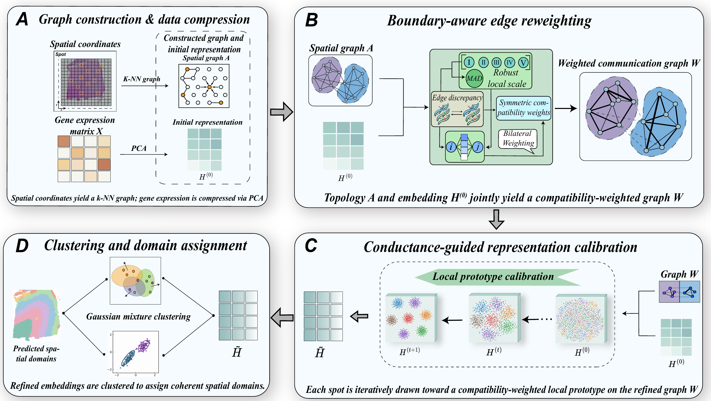

<h1 align="center">BPCal: Boundary-aware Prototype Calibration for Spatial Domain Identification in Spatial Transcriptomics</h1>

<p align="center">
  
      
        
          
            
</p>

**We are actively updating this repository! More features/examples/experiments coming soon!**

## Overview



**BPCal builds a spatial graph, reweights edges according to local compatibility, and iteratively calibrates spot representations toward local prototypes. The calibrated embeddings are then clustered to obtain spatial domains. The entire pipeline is training-free and parameter-free.**

## Requirements

The algorithm itself needs only three packages. No GPU, no deep learning framework.

```
Python=3.9.25
numpy=1.26.4
scipy=1.13.1
scikit-learn=1.6.1
```

## Installation

Install from GitHub

```
git clone https://github.com/SiyuanZhou1024/BPCal.git
cd BPCal
pip install -e .
```

## Repository

```
bpcal/            core implementation
Data_and_Demo/    osmFISH dataset and the tutorial notebook
tests/            unit tests
```

## Datasets

All datasets used in this paper are publicly available. Users can download them from the links below.

**osmFISH**

- The primary source: [Linnarsson Lab osmFISH](http://linnarssonlab.org/osmFISH/)
- The processed version: [drieslab/spatial-datasets](https://github.com/drieslab/spatial-datasets) - or [SODB](https://gene.ai.tencent.com/SpatialOmics/): `codeluppi2018spatial` / `cortex`

**MVC**

- The primary source: [SODB](https://gene.ai.tencent.com/SpatialOmics/): `Wang2018Three_1k` / `mouse_brain_STARmap`
- The processed version: [STARmap datasets on Figshare](https://doi.org/10.6084/m9.figshare.22565209.v1)

**MPFC**

- The primary source: [SODB](https://gene.ai.tencent.com/SpatialOmics/): `Dataset11_MS_process` / `Dataset11_BZ5`, `Dataset11_BZ9`, `Dataset11_BZ14`
- The processed version: [BASS-Analysis starmap_mpfc.RData](https://github.com/zhengli09/BASS-Analysis/blob/master/data/starmap_mpfc.RData)

**DLPFC**

- The primary source: [LieberInstitute/HumanPilot](https://github.com/LieberInstitute/HumanPilot) - or [SODB](https://gene.ai.tencent.com/SpatialOmics/): `maynard2021trans` / `151507`...`151676`
- The processed version: [LieberInstitute/spatialLIBD](https://github.com/LieberInstitute/spatialLIBD)

## Tutorial

All steps of BPCal are demonstrated on the osmFISH dataset in the Jupyter Notebook provided above. The dataset ships with this repository as `osmfish.npz` (160 KB), so the notebook runs end to end without downloading anything.

## Tests

```
pytest
```

The tests verify the core implementation and reproducibility across different k-NN backends.

## Contact
If you have any questions or would like to discuss the method or implementation, please contact us at sorenyuan_zhou@126.com or soren.zhou@outlook.com. The code will be continuously updated and maintained. If you find the ideas and methodology useful, you are welcome to follow the author’s homepage for future open-source projects and updates.
